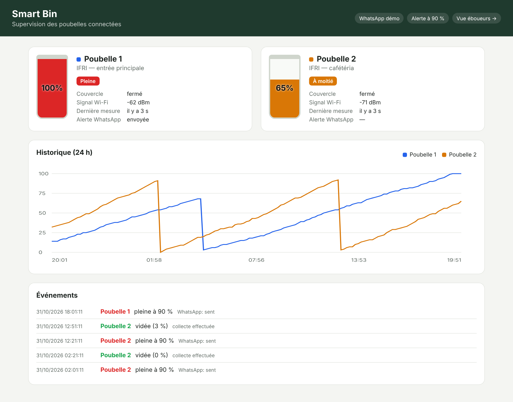
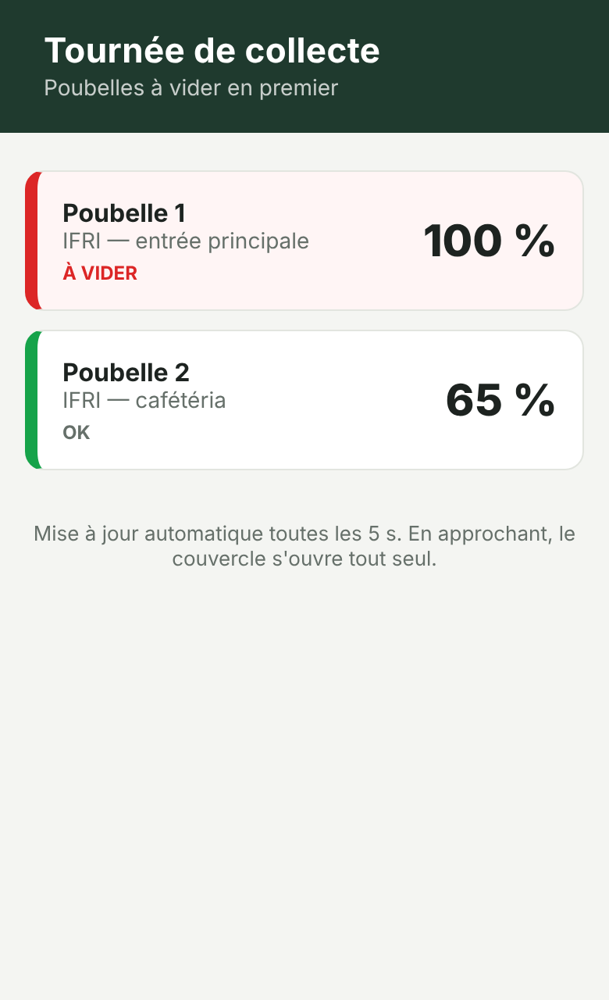
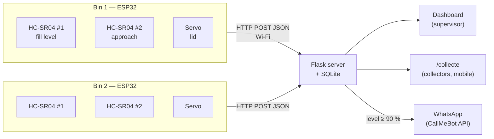

# Smart Bin — Connected Waste Bin (ESP32 · Flask · WhatsApp)

IoT project (Embedded Systems & IoT, **IFRI — Université d'Abomey-Calavi**). Each bin:

- **measures its fill level** automatically;
- **opens its lid by itself** when the collector approaches;
- **warns the collectors on WhatsApp** when it is full.

A **web interface** gives the supervisor a real-time view of every bin.

| Supervisor dashboard | Collectors' mobile page |
| --- | --- |
|  |  |

*(Screenshots made with the demo data of `seed_demo.py`.)*

## Architecture



The demo uses **2 bins, each with 2 ultrasonic sensors and 1 ESP32**:

| Element | Role |
| --- | --- |
| HC-SR04 #1, under the lid | distance to the waste → fill level in % (median of 5 readings, measured lid closed) |
| HC-SR04 #2, on the front | collector closer than 40 cm → the servo opens the lid, which closes 6 s after the last detection |
| SG90 servo | lid |
| Red / green LEDs | full / OK, on the bin itself |
| ESP32 | Wi-Fi, sends `{level, lid_open, rssi}` every 15 s, or at once when the level changes by 5 points |
| Flask server | storage, status (normal / half / full / offline), alerts, web pages |
| WhatsApp | **one message per fill cycle**: sent at 90 %, armed again once the bin has been emptied (≤ 20 %) |

## Server

```bash
cd server
pip install -r requirements.txt
python seed_demo.py        # optional: 24 h of demo data
python app.py              # http://localhost:5000  and  http://localhost:5000/collecte
python simulate_bins.py    # optional: fake bins sending live data
```

Configuration is done with environment variables:

| Variable | Default | Meaning |
| --- | --- | --- |
| `DEVICE_TOKEN` | `change-me` | shared secret, checked on every ESP32 request (`X-Device-Token`) |
| `WHATSAPP_RECIPIENTS` | *(empty = demo)* | `229XXXXXXXX:apikey,229YYYYYYYY:apikey` |
| `ALERT_PCT` / `FULL_PCT` / `EMPTIED_PCT` | 90 / 85 / 20 | thresholds |
| `OFFLINE_S` | 120 | bin marked offline without data for this long |

**WhatsApp (CallMeBot, free):** each collector adds `+34 644 52 74 88` to their contacts and sends *"I allow callmebot to send me messages"*. They then receive their API key. Without configuration, the server logs the messages instead of sending them.

### API

| Method | Route | Description |
| --- | --- | --- |
| `POST` | `/api/bins/<id>/telemetry` | ESP32 → `{"level": 0-100, "lid_open": bool, "rssi": int}` (token required) |
| `GET` | `/api/bins` | status of every bin |
| `GET` | `/api/bins/<id>/history?hours=24` | readings |
| `GET` | `/api/events` | alerts and collections |

**Tests:** `python -m pytest server/tests` runs 6 tests covering authentication, validation, statuses, the single WhatsApp alert and its re-arming after collection, history, and offline detection.

## Firmware (ESP32)

```bash
cd firmware
cp include/secrets.example.h include/secrets.h    # Wi-Fi, server URL, token
pio run -e bin1 -t upload                          # then bin2 on the second ESP32
```

| Component | ESP32 |
| --- | --- |
| HC-SR04 #1 TRIG / ECHO (level) | GPIO 5 / GPIO 18 |
| HC-SR04 #2 TRIG / ECHO (approach) | GPIO 19 / GPIO 21 |
| Servo (lid) | GPIO 13 |
| LED red / green | GPIO 26 / GPIO 27 |

- The HC-SR04s run on 5 V. Each ECHO pin goes through a **1 kΩ / 2 kΩ divider** to protect the 3.3 V inputs.
- The servo also runs on 5 V, and all grounds are common.
- The bin depth and the thresholds are in `include/config.h`.

## Structure

```
firmware/                 PlatformIO project (env bin1 / bin2)
  include/config.h        pins, geometry, thresholds
  src/main.cpp            level, lid, HTTP reports
server/
  app.py                  Flask API + pages
  db.py                   SQLite schema
  notifier.py             WhatsApp (CallMeBot)
  templates/, static/     dashboard and collectors' page
  seed_demo.py            demo data
  simulate_bins.py        fake bins
  tests/test_app.py
```

## Team

Ronice ADEBIAYE · Bradley AZAÏNON · Rodolphe COTCHOE · Elom DEKADJEVI · Uriel GOUNOUKON · Géovic KPOSSILANDE

**Supervisor:** M. Vincent ALLADAGNIWEKE
